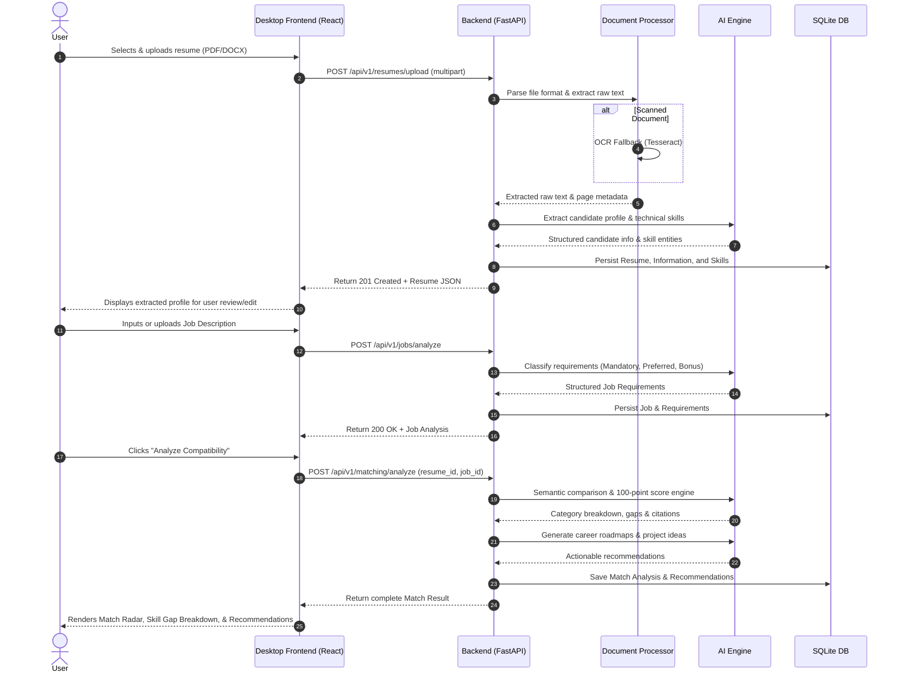

# System Architecture — AI Career Intelligence

**Application:** AI-Powered Resume Analyzer & Job Matcher  
**Platform:** Windows Desktop Application  
**Architectural Style:** Decoupled Desktop-Native Frontend + Local Sidecar REST Service + Local SQLite Database + Embedded AI Engine  

---

## 1. High-Level Architecture Overview

AI Career Intelligence is designed as a **privacy-first, local-native desktop application**. Users evaluate resumes against complex job descriptions without transmitting sensitive personally identifiable information (PII) to third-party cloud servers.

```
+-------------------------------------------------------------------------------+
|                               WINDOWS DESKTOP HOST                            |
|                                                                               |
|  +-------------------------------------------------------------------------+  |
|  |                     FRONTEND (Tauri 2 Native Window)                    |  |
|  |                                                                         |  |
|  |   React 18/19  *  TypeScript  *  Tailwind CSS  *  shadcn/ui             |  |
|  |   Framer Motion  *  Recharts  *  Axios API Client                       |  |
|  +------------------------------------+------------------------------------+  |
|                                       | HTTP / REST (localhost)               |
|                                       v                                       |
|  +-------------------------------------------------------------------------+  |
|  |                BACKEND (FastAPI Local Microservice / Sidecar)           |  |
|  |                                                                         |  |
|  |  +-------------------+  +-------------------+  +---------------------+  |  |
|  |  |  API Routing Layer|  | Business Services |  |  Repositories & ORM |  |  |
|  |  |   (/api/v1/...)   |  |   (Application)   |  |    (SQLAlchemy 2)   |  |  |
|  |  +---------+---------+  +---------+---------+  +----------+----------+  |  |
|  |            |                      |                       |             |  |
|  |            v                      v                       v             |  |
|  |  +-------------------+  +-------------------+  +---------------------+  |  |
|  |  | Document Processor|  |     AI Engine     |  |    SQLite Database  |  |  |
|  |  | (PyMuPDF, docx,   |  | (spaCy, Sentence  |  |   (WAL Mode, Local  |  |  |
|  |  |  LibreOffice, OCR)|  |  Transformers)    |  |    Encrypted/Safe)  |  |  |
|  |  +-------------------+  +-------------------+  +---------------------+  |  |
|  +-------------------------------------------------------------------------+  |
|                                       | Local I/O                             |
|                                       v                                       |
|  +-------------------------------------------------------------------------+  |
|  |                       LOCAL STORAGE LAYER (storage/)                    |  |
|  |   storage/resumes/  *  storage/job_descriptions/  *  storage/reports/   |  |
|  +-------------------------------------------------------------------------+  |
+-------------------------------------------------------------------------------+
```

---

## 2. Core Architectural Principles

### 2.1 Complete Frontend & Backend Decoupling
- **No Shared Runtimes**: The frontend is built entirely using web technologies (React + TypeScript) wrapped in Tauri 2 (Rust). The backend runs as a standalone Python process managed via FastAPI and Uvicorn.
- **RESTful API Contracts**: All data interchange occurs over strictly typed JSON contracts (or `multipart/form-data` for file uploads) defined via Pydantic schemas in Python and mirrored in TypeScript interfaces on the frontend.
- **Independent Evolution**: The frontend can be tested and developed against mock servers or live backend endpoints without requiring direct Python code imports.

### 2.2 Local-First Privacy & Security
- **Zero Cloud Leakage**: No resume text, contact details, work experience, or job description documents leave the user's computer.
- **Cryptographic File Storage**: Resumes are stored using generated UUID v4 tokens (`storage/resumes/{uuid}.{ext}`), preventing path traversal and name collisions.
- **Sanitized Logging**: Personal data is masked in backend application logs to prevent accidental exposure in log files.

### 2.3 Transparent, Deterministic AI Scoring
- **No Hallucinated Qualifications**: The system never generates or invents skills, experiences, or credentials.
- **Evidence-Based Matching**: Every matched, partially matched, or missing skill maintains direct textual citations (evidence excerpts) from the parsed document.
- **Explainable Scoring Distribution**:
  - Mandatory Technical Skills: **40%**
  - Preferred Skills: **15%**
  - Experience Alignment: **15%**
  - Education Alignment: **10%**
  - Practical Projects & Portfolio: **10%**
  - Responsibilities Alignment: **5%**
  - Soft Skills: **5%**

---

## 3. Subsystem Breakdown

### 3.1 Desktop Client (Frontend)
- **Tauri 2**: Provides a lightweight native Windows window with a hardened webview, system tray integration, and native dialogs.
- **React + TypeScript**: Enforces strict compile-time types for API requests and response structures.
- **Design System**: Built on Tailwind CSS and shadcn/ui components for a sleek, responsive interface inspired by Linear and Raycast.
- **State Management & Data Visualization**: React hooks and context handle client state, while Recharts handles score radar charts, skill coverage bars, and distribution histograms.

### 3.2 Backend Service (FastAPI)
- **FastAPI Core**: Provides high-performance asynchronous request handling with automatic OpenAPI documentation (`/docs`, `/redoc`).
- **Core Configuration**: Centralized settings via `pydantic-settings` reading from `.env` or system environment variables.
- **Database & Repositories**: SQLAlchemy 2.0 with the Repository pattern decouples domain logic from SQL operations. SQLite is configured with Write-Ahead Logging (`PRAGMA journal_mode=WAL`) for high-concurrency desktop read/write performance.

### 3.3 Document Processing Engine
- **Multi-Format Ingestion**:
  - **PDF**: PyMuPDF (`fitz`) for rapid text and font metadata extraction.
  - **DOCX**: `python-docx` for structured paragraph and table extraction.
  - **DOC**: Headless LibreOffice conversion pipeline converting legacy binary `.doc` to `.pdf` or text.
  - **TXT / RTF**: Native Python file I/O with `chardet` encoding detection and `striprtf` RTF stripping.
  - **Scanned PDF / OCR**: Tesseract OCR fallback (`pytesseract`) activated automatically when text density falls below a minimum readability threshold.

### 3.4 AI & NLP Engine
- **Skill Extraction**: Pre-trained spaCy NLP pipelines supplemented with curated technical taxonomy entity rules to extract tools, languages, frameworks, and domain knowledge.
- **Semantic Vector Embeddings**: Sentence Transformers (`sentence-transformers/all-MiniLM-L6-v2`) generate dense vector representations to evaluate semantic equivalence between resume expressions and job requirements.
- **Rule-Based Validation**: High-confidence cosine similarity thresholds combined with token-level heuristics prevent false-positive matching.

---

## 4. End-to-End Processing Workflow



---

## 5. Desktop Packaging & Process Lifecycle

In production (Phase 10):
1. **Packaging**: The Python backend is bundled as a single executable using PyInstaller.
2. **Process Orchestration**: When the Tauri native app starts, it checks port availability, spawns the local Python backend sidecar, and polls `GET /api/v1/health` until ready.
3. **Graceful Teardown**: When the user exits the desktop application, Tauri sends a termination signal (`SIGTERM` / `WM_CLOSE`) to cleanly stop the FastAPI backend and close SQLite database connections.
