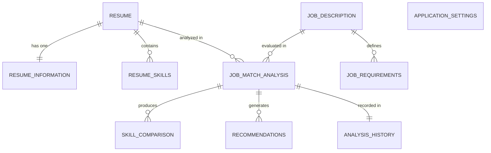

# Database Schema Specification — AI Career Intelligence

**Engine:** SQLite 3  
**ORM:** SQLAlchemy 2.0 (Declarative Base with Mapped Type Annotations)  
**Location:** `storage/career_intelligence.db`  
**Configuration:** `PRAGMA foreign_keys = ON;`, `PRAGMA journal_mode = WAL;`

---

## Entity Relationship Overview



---

## Table Definitions

### 1. `resumes`
Stores primary metadata and storage pointers for uploaded candidate resume documents.

| Column | Type | Constraints | Description |
|---|---|---|---|
| `id` | VARCHAR(36) | PRIMARY KEY | UUID v4 unique identifier |
| `original_filename` | VARCHAR(255) | NOT NULL | User's uploaded file name |
| `file_format` | VARCHAR(10) | NOT NULL | Format: `pdf`, `docx`, `doc`, `txt`, `rtf` |
| `file_size_bytes` | INTEGER | NOT NULL | Size in bytes |
| `stored_file_path` | VARCHAR(512) | NOT NULL | Relative path in `storage/resumes/` |
| `raw_text` | TEXT | NULL | Full extracted document text |
| `processing_status` | VARCHAR(20) | DEFAULT 'pending' | `pending`, `parsed`, `failed` |
| `is_confirmed` | BOOLEAN | DEFAULT FALSE | Whether candidate reviewed extracted data |
| `created_at` | DATETIME | NOT NULL | Creation timestamp (UTC) |
| `updated_at` | DATETIME | NOT NULL | Last update timestamp (UTC) |

---

### 2. `resume_information`
Stores structured personal, professional, and educational data extracted from the resume.

| Column | Type | Constraints | Description |
|---|---|---|---|
| `id` | VARCHAR(36) | PRIMARY KEY | UUID v4 unique identifier |
| `resume_id` | VARCHAR(36) | FOREIGN KEY (resumes.id) ON DELETE CASCADE, UNIQUE | Associated resume |
| `full_name` | VARCHAR(255) | NULL | Candidate's name |
| `email` | VARCHAR(255) | NULL | Contact email |
| `phone` | VARCHAR(50) | NULL | Contact phone number |
| `location` | VARCHAR(255) | NULL | City, State, Country |
| `summary` | TEXT | NULL | Executive / professional summary |
| `education_json` | JSON | NULL | Array of degrees, institutions, years |
| `experience_json` | JSON | NULL | Array of work history objects |
| `internships_json` | JSON | NULL | Array of internship objects |
| `projects_json` | JSON | NULL | Array of portfolio / academic projects |
| `certifications_json` | JSON | NULL | Array of certifications |
| `created_at` | DATETIME | NOT NULL | Timestamp |
| `updated_at` | DATETIME | NOT NULL | Timestamp |

---

### 3. `resume_skills`
Normalized list of individual skills extracted from the candidate's resume with contextual evidence.

| Column | Type | Constraints | Description |
|---|---|---|---|
| `id` | VARCHAR(36) | PRIMARY KEY | UUID v4 unique identifier |
| `resume_id` | VARCHAR(36) | FOREIGN KEY (resumes.id) ON DELETE CASCADE | Associated resume |
| `skill_name` | VARCHAR(100) | NOT NULL | Canonical/normalized skill name |
| `category` | VARCHAR(50) | NOT NULL | `language`, `framework`, `database`, `cloud`, `devops`, `ai_ml`, `soft_skill` |
| `years_of_experience` | FLOAT | NULL | Estimated or stated years of experience |
| `evidence_text` | TEXT | NULL | Exact excerpt from resume where skill was found |
| `created_at` | DATETIME | NOT NULL | Timestamp |

*Indexes:* `CREATE INDEX idx_resume_skills_resume_id ON resume_skills(resume_id);`  
*Indexes:* `CREATE INDEX idx_resume_skills_name ON resume_skills(skill_name);`

---

### 4. `job_descriptions`
Stores job postings uploaded via document or pasted directly by the user.

| Column | Type | Constraints | Description |
|---|---|---|---|
| `id` | VARCHAR(36) | PRIMARY KEY | UUID v4 unique identifier |
| `title` | VARCHAR(255) | NOT NULL | Job title (e.g., Senior Full Stack Engineer) |
| `company` | VARCHAR(255) | NULL | Hiring organization |
| `industry` | VARCHAR(100) | NULL | Industry sector |
| `location` | VARCHAR(255) | NULL | Location (e.g., Remote, Seattle, WA) |
| `raw_text` | TEXT | NOT NULL | Full source job description text |
| `source_type` | VARCHAR(20) | DEFAULT 'paste' | `paste`, `upload` |
| `min_experience_years` | FLOAT | NULL | Minimum required years of experience |
| `education_level` | VARCHAR(100) | NULL | Required degree level |
| `created_at` | DATETIME | NOT NULL | Timestamp |
| `updated_at` | DATETIME | NOT NULL | Timestamp |

---

### 5. `job_requirements`
Structured requirement elements parsed and classified from the job description.

| Column | Type | Constraints | Description |
|---|---|---|---|
| `id` | VARCHAR(36) | PRIMARY KEY | UUID v4 unique identifier |
| `job_id` | VARCHAR(36) | FOREIGN KEY (job_descriptions.id) ON DELETE CASCADE | Associated job |
| `requirement_name` | VARCHAR(255) | NOT NULL | Skill or requirement term |
| `category` | VARCHAR(50) | NOT NULL | Category (e.g., `technical`, `education`, `experience`, `soft_skill`) |
| `classification` | VARCHAR(20) | NOT NULL | `mandatory`, `preferred`, `optional`, `bonus` |
| `required_experience_years`| FLOAT | NULL | Required years for this specific skill |
| `evidence_text` | TEXT | NOT NULL | Exact excerpt from job description |
| `is_ambiguous` | BOOLEAN | DEFAULT FALSE | Flagged if requirement has vague phrasing |
| `created_at` | DATETIME | NOT NULL | Timestamp |

*Indexes:* `CREATE INDEX idx_job_reqs_job_id ON job_requirements(job_id);`

---

### 6. `job_match_analyses`
Aggregate scoring and evaluation records connecting a specific resume to a specific job description.

| Column | Type | Constraints | Description |
|---|---|---|---|
| `id` | VARCHAR(36) | PRIMARY KEY | UUID v4 unique identifier |
| `resume_id` | VARCHAR(36) | FOREIGN KEY (resumes.id) ON DELETE CASCADE | Evaluated resume |
| `job_id` | VARCHAR(36) | FOREIGN KEY (job_descriptions.id) ON DELETE CASCADE | Target job description |
| `overall_match_score` | FLOAT | NOT NULL | 0.0 to 100.0 aggregate score |
| `mandatory_skills_score` | FLOAT | NOT NULL | Score component (out of 40%) |
| `preferred_skills_score` | FLOAT | NOT NULL | Score component (out of 15%) |
| `experience_score` | FLOAT | NOT NULL | Score component (out of 15%) |
| `education_score` | FLOAT | NOT NULL | Score component (out of 10%) |
| `projects_score` | FLOAT | NOT NULL | Score component (out of 10%) |
| `responsibilities_score` | FLOAT | NOT NULL | Score component (out of 5%) |
| `soft_skills_score` | FLOAT | NOT NULL | Score component (out of 5%) |
| `eligibility_status` | VARCHAR(30) | NOT NULL | `satisfied`, `partially_satisfied`, `not_satisfied` |
| `eligibility_summary` | TEXT | NOT NULL | Transparent natural language summary |
| `weights_applied_json` | JSON | NOT NULL | Exact weight snapshot used during calculation |
| `created_at` | DATETIME | NOT NULL | Timestamp |

---

### 7. `skill_comparisons`
Detailed item-by-item alignment for each required skill vs resume evidence.

| Column | Type | Constraints | Description |
|---|---|---|---|
| `id` | VARCHAR(36) | PRIMARY KEY | UUID v4 unique identifier |
| `match_analysis_id` | VARCHAR(36) | FOREIGN KEY (job_match_analyses.id) ON DELETE CASCADE | Associated analysis |
| `requirement_id` | VARCHAR(36) | FOREIGN KEY (job_requirements.id) ON DELETE CASCADE | Evaluated requirement |
| `skill_name` | VARCHAR(100) | NOT NULL | Normalized skill name |
| `match_status` | VARCHAR(25) | NOT NULL | `matched`, `partially_matched`, `missing`, `not_verifiable` |
| `semantic_score` | FLOAT | DEFAULT 0.0 | Cosine similarity value (0.0 - 1.0) |
| `resume_evidence` | TEXT | NULL | Excerpt from resume supporting match |
| `explanation` | TEXT | NOT NULL | Human-readable explanation of why status was assigned |
| `created_at` | DATETIME | NOT NULL | Timestamp |

---

### 8. `recommendations`
Actionable AI career and skill development recommendations derived from the gap analysis.

| Column | Type | Constraints | Description |
|---|---|---|---|
| `id` | VARCHAR(36) | PRIMARY KEY | UUID v4 unique identifier |
| `match_analysis_id` | VARCHAR(36) | FOREIGN KEY (job_match_analyses.id) ON DELETE CASCADE | Associated analysis |
| `type` | VARCHAR(50) | NOT NULL | `learning_path`, `project_idea`, `resume_bullet`, `interview_prep` |
| `priority` | VARCHAR(20) | NOT NULL | `high`, `medium`, `low` |
| `target_skill` | VARCHAR(100) | NULL | Skill or gap addressed |
| `title` | VARCHAR(255) | NOT NULL | Concise recommendation headline |
| `description` | TEXT | NOT NULL | Detailed action step |
| `rationale` | TEXT | NOT NULL | Why this recommendation improves candidacy |
| `created_at` | DATETIME | NOT NULL | Timestamp |

---

### 9. `analysis_history`
Searchable audit log for quickly listing historical matches on the dashboard.

| Column | Type | Constraints | Description |
|---|---|---|---|
| `id` | VARCHAR(36) | PRIMARY KEY | UUID v4 unique identifier |
| `match_analysis_id` | VARCHAR(36) | FOREIGN KEY (job_match_analyses.id) ON DELETE CASCADE | Direct analysis reference |
| `resume_name` | VARCHAR(255) | NOT NULL | Snapshot of candidate or file name |
| `job_title` | VARCHAR(255) | NOT NULL | Snapshot of job title |
| `company_name` | VARCHAR(255) | NULL | Snapshot of company |
| `overall_score` | FLOAT | NOT NULL | Match score snapshot |
| `matched_count` | INTEGER | NOT NULL | Count of matched requirements |
| `missing_count` | INTEGER | NOT NULL | Count of missing requirements |
| `analysis_date` | DATETIME | NOT NULL | Execution date |

---

### 10. `application_settings`
Configurable local desktop settings and custom scoring weight profiles.

| Column | Type | Constraints | Description |
|---|---|---|---|
| `key` | VARCHAR(100) | PRIMARY KEY | Setting key identifier |
| `value_json` | JSON | NOT NULL | Setting value (e.g., custom weights) |
| `updated_at` | DATETIME | NOT NULL | Last modified timestamp |

*Default Key-Values:*
- `scoring_weights`:
  ```json
  {
    "mandatory_skills": 40.0,
    "preferred_skills": 15.0,
    "experience_alignment": 15.0,
    "education_alignment": 10.0,
    "projects_practical": 10.0,
    "responsibilities": 5.0,
    "soft_skills": 5.0
  }
  ```
- `ocr_settings`: `{"enabled": true, "fallback_threshold_chars": 50}`
- `theme`: `{"mode": "dark"}`
