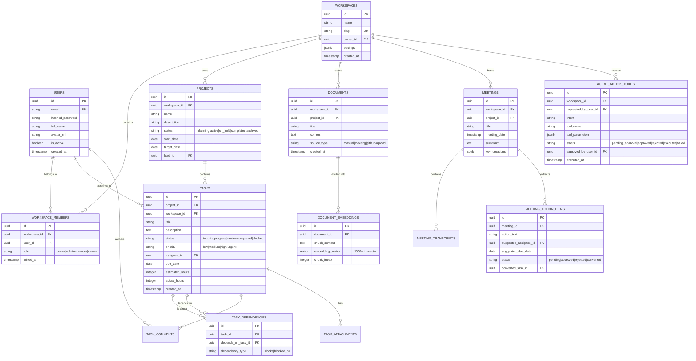
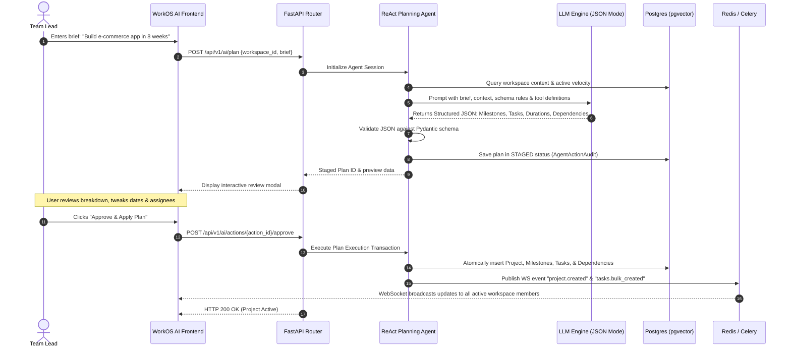

# WorkOS AI – System Architecture Documentation

## 1. Executive Summary

**WorkOS AI** is an enterprise-grade, multi-tenant AI Operating System for Teams that synthesizes project management, meeting intelligence, document knowledge, team collaboration, and proactive agentic reasoning into a unified platform. 

The system enables teams to convert unstructured briefs and discussions into structured project graphs, automatically detects cross-project dependency blockers, predicts delivery timeline delays, maintains conversational workspace RAG memory, and executes human-in-the-loop AI actions.

---

## 2. High-Level System Architecture

The architecture is built on a decoupled, micro-service ready, domain-driven design:

```mermaid
graph TD
    subgraph Client Layer
        WebClient["React + TypeScript SPA (Vite, Tailwind, Shadcn)"]
        WSClient["WebSocket Client (Real-time updates)"]
    end

    subgraph API Gateway & Ingress
        Nginx["Reverse Proxy / SSL Termination"]
    end

    subgraph Backend Application (FastAPI)
        AuthMiddleware["JWT & Workspace Security Guard"]
        RESTRouter["REST API v1 Router"]
        WSRouter["WebSocket Manager & Broadcast"]
        DomainServices["Domain Services (Projects, Tasks, Meetings)"]
        AgentEngine["ReAct Agent Engine & Tool Registry"]
    end

    subgraph Async & Background Workers (Celery)
        CeleryWorker["Celery Worker Nodes"]
        CeleryBeat["Periodic Scheduler (Risk Detection Engine)"]
    end

    subgraph Data & Persistence Layer
        Postgres[("PostgreSQL 16 + pgvector (Relational & Vector Data)")]
        RedisDB[("Redis 7 (Session Cache, Celery Broker, Pub/Sub)")]
    end

    subgraph External AI & Services
        LLM["LLM Provider (Gemini / Anthropic / OpenAI)"]
        GitHubAPI["GitHub REST/GraphQL API"]
    end

    WebClient -->|HTTPS REST| Nginx
    WSClient -->|WSS| Nginx
    Nginx --> AuthMiddleware
    AuthMiddleware --> RESTRouter
    AuthMiddleware --> WSRouter
    RESTRouter --> DomainServices
    DomainServices --> AgentEngine
    DomainServices --> Postgres
    WSRouter <--> RedisDB
    DomainServices --> RedisDB
    RedisDB --> CeleryWorker
    CeleryWorker --> Postgres
    CeleryWorker --> LLM
    CeleryBeat --> RedisDB
    AgentEngine --> LLM
    DomainServices --> GitHubAPI
```

---

## 3. Technology Stack Specification

| Tier | Component | Technology | Rationale |
|---|---|---|---|
| **Frontend** | Framework | React 18+, TypeScript | Type safety, component modularity, ecosystem maturity |
| | Styling & UI | Tailwind CSS, Lucide Icons, Shadcn UI patterns | Modern desktop-first enterprise aesthetic, accessibility |
| | State Management | Zustand & TanStack Query | Client state isolation and server-cache synchronization |
| | Real-Time | Native WebSocket Client with auto-reconnect | Low-latency state synchronization for Kanban and presence |
| **Backend** | Framework | Python 3.11+, FastAPI, Uvicorn | Async performance, auto OpenAPI generation, native Pydantic |
| | ORM & DB Access | SQLAlchemy 2.0 (AsyncIO), Alembic | Clean schema migrations, repository abstraction |
| | Background Jobs | Celery, Redis | Non-blocking document vectorization and scheduled health scans |
| **Data Layer** | Relational & Vector | PostgreSQL 16 with `pgvector` | Unified relational ACID consistency and 1536/768-dim embeddings |
| | Cache & Message Broker| Redis 7 | Sub-millisecond session caching, Celery queue, Pub/Sub channels |
| **AI Layer** | Orchestration | ReAct Framework with Structured Output | Transparent tool calling, auditability, human approval gating |
| | Embeddings & Search | Vector Cosine Distance (`<=>`), Chunking (500 tokens, 10% overlap) | High-recall semantic retrieval across workspace assets |

---

## 4. Multi-Tenant Isolation & Security Model

### Tenant Isolation Guarantee
WorkOS AI enforces **strict logical tenant isolation** at the database, service, and cache levels.
1. **Header & Context Verification**: Every request targeting workspace data must specify the target workspace via path parameter `/workspaces/{workspace_id}/...` or header `X-Workspace-ID`.
2. **FastAPI Authorization Dependency (`get_current_workspace_member`)**:
   - Validates the user's JWT access token.
   - Queries `workspace_members` for `(user_id, workspace_id)`.
   - Injects the authenticated member's role (`owner`, `admin`, `member`, `viewer`) into request context.
   - Denies request with HTTP 403 Forbidden if membership does not exist or user lacks required privileges.
3. **Database Scoping**:
   - All core entity tables (`projects`, `tasks`, `documents`, `meetings`, `agent_action_audits`) carry a non-nullable foreign key `workspace_id`.
   - Every repository query explicitly appends `.where(Entity.workspace_id == current_workspace_id)`.
4. **Vector Memory Scoping**:
   - Document chunk embeddings stored in `document_embeddings` join against `documents` to guarantee pgvector cosine similarity searches are hard-filtered by `workspace_id`. Cross-workspace data leakage is mathematically impossible.

### Role-Based Access Control (RBAC) Matrix

| Action | Viewer | Member | Admin | Owner |
|---|:---:|:---:|:---:|:---:|
| Read Projects / Tasks / Docs | ✅ | ✅ | ✅ | ✅ |
| Create / Edit Tasks & Comments | ❌ | ✅ | ✅ | ✅ |
| Run AI Assistant / RAG Queries | ✅ | ✅ | ✅ | ✅ |
| Approve AI Action Plans | ❌ | ❌ | ✅ | ✅ |
| Create / Archive Projects | ❌ | ❌ | ✅ | ✅ |
| Manage Workspace Members | ❌ | ❌ | ✅ | ✅ |
| Billing & Delete Workspace | ❌ | ❌ | ❌ | ✅ |

---

## 5. Database Architecture & Schema Design



---

## 6. AI Agent & Reasoning Architecture

The AI subsystem implements a disciplined **ReAct (Reasoning and Acting)** lifecycle with mandatory human approval gating for all state-mutating actions:



### Safety & Approval Governance
1. **Read Tools (Autonomous)**: Vector retrieval, task list filtering, timeline calculation, dependency risk checks execute immediately without gating.
2. **Write Tools (Gated)**: Creating tasks, modifying deadlines, reassigning owners, and deleting entities generate an `AgentActionAudit` record with `status: pending_approval`.
3. **Execution Enforcement**: The system rejects automated writes; an authorized workspace Admin or Owner must issue an explicit approval request with their user identity logged for audit compliance.

---

## 7. Real-Time Collaboration & WebSockets

### Architecture
- **State Broker**: Redis Pub/Sub connects multiple stateless FastAPI worker instances.
- **Connection Channel**: Each active client maintains an authenticated WebSocket connection at `/api/v1/ws/{workspace_id}?token={jwt}`.
- **Subscription**: On handshake, the connection joins the Redis channel `workspace:{workspace_id}`.
- **Message Types**:
  - `task.created` / `task.updated` / `task.moved` (Kanban drag-and-drop)
  - `presence.update` (Active user list and avatars)
  - `agent.action_proposed` / `agent.action_executed`
  - `notification.broadcast`

---

## 8. Asynchronous Background Workers (Celery)

Long-running tasks are offloaded from FastAPI request-response threads:
1. **Document Embedding Pipeline**:
   - Triggered on document upload or meeting notes generation.
   - Cleans text, partitions into 500-token chunks with 50-token overlap.
   - Calls embedding API.
   - Persists vectors to `document_embeddings` via batch insert.
2. **Project Risk Detection Engine (Periodic Celery Beat)**:
   - Scans active projects every 15 minutes.
   - Detects: overdue tasks, dependency deadlocks, blocked tasks on critical paths.
   - Computes project health metrics (`Low`, `Medium`, `High`, `Critical`).
   - Dispatches warning notifications if a milestone deadline is jeopardized.
3. **GitHub Sync Worker**:
   - Ingests incoming GitHub webhook payloads (commits, PRs).
   - Links commits matching `#TASK-ID` pattern to tasks.
   - Auto-transitions tasks from `In Progress` to `Review` on PR open.

---

## 9. Logging, Telemetry & Standardized Error Handling

### Structured JSON Logging
All application logs are formatted as structured JSON:
```json
{
  "timestamp": "2026-11-02T14:45:00Z",
  "level": "INFO",
  "service": "workos-api",
  "workspace_id": "8f3b6c20-...",
  "user_id": "1a2b3c...",
  "request_id": "req-98741",
  "event": "ai_plan_generated",
  "duration_ms": 1420
}
```

### Standardized Error Response Format (RFC 7807 aligned)
```json
{
  "error": {
    "code": "WORKSPACE_ACCESS_DENIED",
    "message": "User is not a member of the requested workspace.",
    "details": {
      "workspace_id": "8f3b6c20-...",
      "required_role": "member"
    },
    "request_id": "req-98741"
  }
}
```
All domain errors inherit from `WorkOSAppException` and map directly to predictable HTTP status codes.

